 

&nbsp;
&nbsp;

 

Sou desenvolvedor de software formado em **Ciência da Computação** e, há mais de 5 anos, crio, mantenho e vendo meus próprios produtos para o ecossistema **FiveM** com a **Nation Resources**. Lidero um time pequeno e cuido do produto de ponta a ponta: da lógica de jogo em **Lua** até a infraestrutura por trás dela, com API própria de autenticação e licenciamento, controle de versões, banco de dados, pagamentos e automações no Discord.

 

 

- **Dentro do jogo:** resources client/server em Lua e interfaces NUI em HTML, CSS e JavaScript.
- **Fora do jogo:** API própria em Node.js e Express para autenticação, licenciamento, controle de versões e mecanismos de segurança.
- **Em volta:** MySQL/MariaDB, Mercado Pago, bot e webhooks do Discord, tudo rodando em VPS com Cloudflare e Apache/Nginx.

### `// projetos em destaque`

<table>
<tr>
<td width="50%" valign="top">
<a href="https://github.com/yurisdl/jungle-backend-challenge"><b>Distributed Wagering Processor</b></a> 
Bun · TypeScript · NestJS · PostgreSQL · SQS

Processador de apostas distribuído com carteira, ledger, idempotência, inbox/outbox e controle de concorrência entre várias instâncias, com testes de propriedade e de queda de infraestrutura.

</td>
<td width="50%" valign="top">
<a href="https://www.youtube.com/@nation3713"><b>Nation Resources</b></a> 
Lua · Node.js · Express · MySQL · Mercado Pago · Discord

Catálogo de produtos comerciais para servidores FiveM, com API própria de autenticação, licenças e versões por trás de cada resource.

</td>
</tr>
<tr>
<td width="50%" valign="top">
<b>Sistema de garagem · Hype Roleplay</b> 
Lua · NUI · MySQL · trabalho em time via GitHub

Desenvolvimento e manutenção do sistema de garagem e gerenciamento de veículos dos jogadores, script exclusivo do servidor.

</td>
<td width="50%" valign="top">
<b>Chatbot de atendimento via WhatsApp com NLP</b> 
TCC · processamento de linguagem natural · e-commerce

Trabalho de conclusão de curso aplicando NLP ao atendimento de um e-commerce, fora do universo FiveM.

</td>
</tr>
</table>

 

 

<picture>
  <source media="(prefers-color-scheme: dark)" srcset="https://raw.githubusercontent.com/yurisdl/yurisdl/output/snake-dark.svg"/>
  <source media="(prefers-color-scheme: light)" srcset="https://raw.githubusercontent.com/yurisdl/yurisdl/output/snake.svg"/>
  
</picture>

